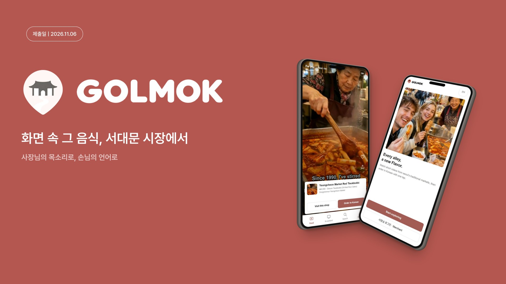
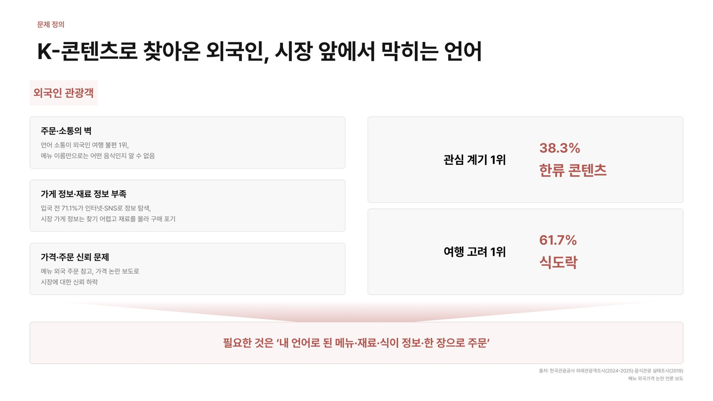
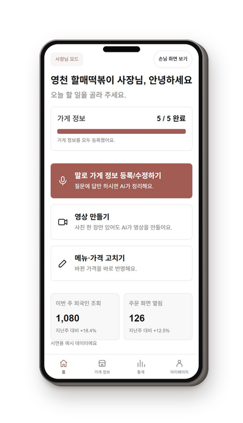
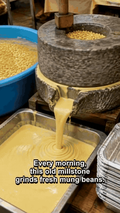
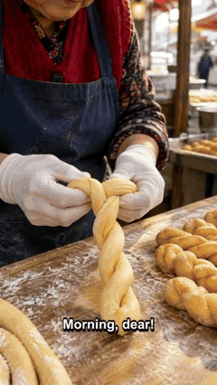
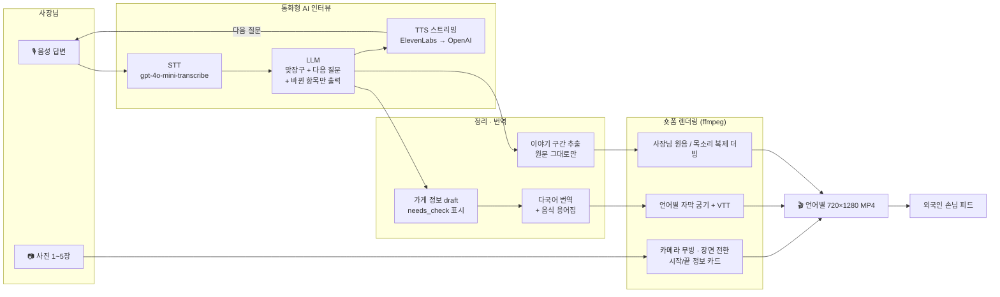
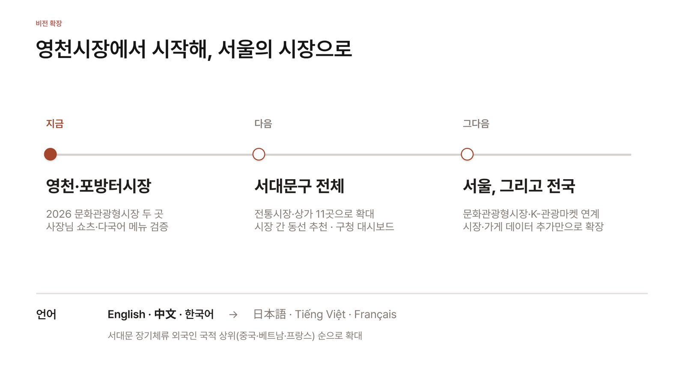

<p align="center">
  
</p>

<h1 align="center">골목 GOLMOK</h1>

<p align="center">
  <b>사장님의 목소리로, 손님의 언어로</b><br>
  전통시장 사장님이 <b>말로 가게를 등록</b>하고 <b>사진 몇 장</b>을 올리면,<br>
  AI가 <b>다국어 가게 정보</b>와 <b>사장님 목소리로 더빙된 세로 숏폼</b>을 만들어 외국인 손님과 연결합니다.
</p>

<p align="center">
  
</p>

<p align="center">
  
  
  
  
  
  
</p>

> 🏆 **명지대학교 2026학년도 AI 창의적 아이디어 해커톤 경진대회 최우수상** (2026.11, 해커톤 11조)
>
> 이 저장소는 골목의 **백엔드(API)** 입니다. 원본: [Gopistol/hackathon-api](https://github.com/Gopistol/hackathon-api)

<br>

## 목차

1. [문제 정의](#문제-정의)
2. [왜 서대문구인가](#왜-서대문구인가)
3. [서비스 소개](#서비스-소개)
4. [실제 화면](#실제-화면)
5. [AI 파이프라인](#ai-파이프라인)
6. [내가 맡은 부분](#내가-맡은-부분)
7. [기대 효과와 확장](#기대-효과와-확장)
8. [기술 스택 · 실행 방법](#기술-스택)
9. [팀](#팀)

<br>

## 문제 정의

외국인은 K-드라마와 숏폼에서 본 음식을 먹으러 시장에 오지만 **메뉴를 읽을 수 없고**,
수십 년 장사한 사장님은 **그 이야기를 외국인에게 전할 방법이 없습니다.**

| 외국인 관광객 | 시장 사장님 |
| :---: | :---: |
|  |  |
| 관심 계기 1위 **한류 콘텐츠 38.3%** · 여행 고려 1위 **식도락 61.7%**<br>그런데 언어 소통이 여행 불편 1위 | 상인 평균 **60.2세** · 60대 이상 **57.6%**<br>번역·디자인·영상 제작 모두 부담 |
| → *내 언어로 된 메뉴, 재료·식이 정보, 한 장으로 끝나는 주문* | → *쉬운 다국어 홍보, 가격 투명 공개, 1분 등록* |

<sub>출처: 한국관광공사 외래관광객조사(2024·2025), 음식관광 실태조사(2019), 소상공인시장진흥공단 전통시장 점포경영 실태조사(2022)</sub>

<br>

## 왜 서대문구인가

<p align="center">
  
</p>

서울 열린데이터광장 생활인구 데이터를 직접 분석했습니다.

- 학기 중 평일 낮 **장기체류 외국인 생활인구 18,629명** — 서울 25개 구 중 2위
- 낮 시간 **20~24세 비중 9.6%** — 서울 평균(5.4%)의 약 1.8배, 서울 2위
- **영천시장 · 포방터시장** 2026 문화관광형시장 동시 선정 → 1차 대상

<br>

## 서비스 소개

<p align="center">
  
</p>

| 누가 | 무엇을 | 결과 |
| --- | --- | --- |
| **사장님** | 전화 받듯 AI와 대화하며 가게 등록 + 가게 사진 1~5장 | 버튼 없이, 말만으로 등록 |
| **골목 AI** | 대화 내용 정리 · 번역 · 숏폼 렌더링 | 다국어 가게 정보 + 사장님 목소리 더빙 쇼츠 |
| **손님** | 피드에서 쇼츠 시청 → 가게 상세 → 주문 카드 | 한국어 주문 카드를 사장님께 보여주면 주문 끝 |

지원 언어: **English · 中文 · 한국어**

<br>

## 실제 화면

<table>
  <tr>
    <td align="center"></td>
    <td align="center"></td>
    <td align="center"></td>
    <td align="center"></td>
  </tr>
  <tr>
    <td align="center"><b>사장님</b><br>말로 가게 등록</td>
    <td align="center"><b>피드</b><br>사장님 이야기 쇼츠</td>
    <td align="center"><b>K-콘텐츠</b><br>드라마 속 음식 찾기</td>
    <td align="center"><b>주문 카드</b><br>한국어로 주문</td>
  </tr>
</table>

### AI가 만든 숏폼 (발표 시연용)

사진과 사장님 이야기로 만든 20~30초 세로 영상입니다. 언어마다 자막을 굽고, 사장님 목소리를 복제해 더빙합니다.

<p align="center">
  
  &nbsp;
  
  &nbsp;
  
</p>

<br>

## AI 파이프라인



**라이브 데모가 끊기지 않게** 모든 외부 호출에 대체 동작을 두었습니다.

| 단계 | 실패 시 |
| --- | --- |
| 음성 인식 | 에러 대신 `heard: false`로 같은 질문을 다시, 반복 실패 시 말하기 팁 안내 |
| LLM 정리 | JSON 재시도 → 고정 질문 + 규칙 기반 정리로 같은 흐름 유지 |
| 번역 | 음식 용어집 → 한국어 원문 |
| 더빙 | 목소리 복제(ElevenLabs) → AI 기본 목소리(OpenAI) → 사장님 원음 → 무음 |
| 렌더링 | job `failed` 처리, 미리 렌더링한 시연 영상은 피드에 유지 |

<br>

## 내가 맡은 부분

**전예준** — 서비스 기획 · AI 인터뷰 / 숏폼 파이프라인 개발

#### 1. 통화형 AI 인터뷰 (`app/services/interview.py`)
- 60대 사장님도 쓸 수 있도록 **버튼 없이 전화처럼 이어지는 대화** 설계 — AI 음성 재생 → 자동 녹음 → 말이 멈추면 전송
- 한 턴 = STT 1번 + LLM 1번 (실측 **1~3초**). LLM은 할 말과 바뀐 항목만 출력하게 해 응답을 줄이고, 맞장구("네~")는 즉시 재생, TTS는 생성하는 대로 스트리밍
- **register** 모드: 업종에 맞춰 이름 → 상품·가격 → 결제 → 영업시간 → 업종별 질문(원산지, 맵기, 택배 등)을 묻고, 사장님이 말로 고치면 다음 턴에 반영
- **story** 모드: 시작 · 세월 · 손맛 · 사람 · 한마디 축으로 꼬리 질문을 이어 사장님 인생 이야기를 끌어냄
- 어르신·시장 소음 환경 대응: STT 시간 제한, 반복 인식 실패 시 말하기 팁, 네트워크·마이크 오류에도 끊기지 않는 데모 페이지

#### 2. 사장님 목소리 숏폼 (`app/services/video.py`)
- 생성형 영상 모델 대신 **실제 가게 사진 + ffmpeg 템플릿 합성** — 실제 음식과 다르게 보일 위험을 없애고, 1장만으로도 확대·이동·축소 구간을 나눠 20~30초 구성
- 언어별 자막을 영상에 굽고 플레이어용 VTT도 함께 생성, 시작에 가게 이름 · 끝에 메뉴·가격·결제 카드
- 한국어 영상은 **사장님 원래 목소리**, 외국어 영상은 **사장님 목소리를 복제해 더빙**
- 이야기 인터뷰에서 **사장님이 실제로 한 말만** 2~5개 구간으로 골라(원문에 없는 문장은 버려 환각 차단) 음성 정렬로 원 녹음에서 잘라 이어 붙임

<br>

## 기대 효과와 확장

<p align="center">
  
</p>

| 대상 | 효과 | 지표 |
| --- | --- | --- |
| 외국인 관광객 | 화면 속 음식을 시장에서 직접 맛보고, 가게의 이야기까지 경험 | 콘텐츠 시청 → 저장·길찾기 전환율 |
| 시장 사장님 | 사진과 30초 음성만으로 다국어 메뉴·홍보 영상 확보 | 언어별 영상 조회 수, 주문 수 |
| 서대문구·상인회 | 나라별 손님 수요 데이터로 시장 지원 정책 근거 확보 | 나라별 방문 수, 인기 메뉴 순위 |

<p align="center">
  
</p>

**영천·포방터시장 → 서대문구 전체(11곳) → 서울, 그리고 전국.**
언어도 서대문 장기체류 외국인 국적 순으로 日本語 · Tiếng Việt · Français까지 확장합니다.

<br>

## 기술 스택

| 영역 | 사용 기술 |
| --- | --- |
| API 서버 | FastAPI, Pydantic Settings, Uvicorn |
| DB | SQLite + SQLAlchemy 2.x |
| LLM | OpenAI `gpt-4.1-mini` (프로바이더 교체 가능: `openai` / `anthropic` / `mock`) |
| 음성 인식 | OpenAI `gpt-4o-mini-transcribe` |
| 음성 합성·더빙 | ElevenLabs (TTS, 목소리 복제, 음성 정렬), OpenAI `gpt-4o-mini-tts` |
| 영상 | ffmpeg (imageio-ffmpeg), Pillow |
| 배포 | VM + systemd + Caddy (메모리 600MB, 워커 1개) |

### 실행 방법

```bash
python3 -m venv .venv
.venv/bin/pip install -r requirements-dev.txt
cp .env.example .env                        # 키 없이 두면 mock 모드로 전체 흐름 동작
.venv/bin/uvicorn app.main:app --reload     # http://127.0.0.1:8000/docs
.venv/bin/pytest                            # 네트워크·키 없이 테스트
```

API 명세, 환경변수, 시드·리셋, 서버 배포 방법은 **[개발 문서](docs/DEVELOPMENT.md)** 에 정리되어 있습니다.

### 프로젝트 구조

```text
app/
├── api/v1/          # customer(피드·가게·주문) / merchant(등록·인터뷰·영상) / admin(리셋)
├── services/
│   ├── interview.py # 통화형 AI 인터뷰 (register · story)
│   ├── video.py     # 숏폼 렌더링 · 더빙 · 이야기 구간 이어 붙이기
│   ├── ai.py        # STT · 정리 · 번역 · 자막 (mock · 실패 대체 포함)
│   ├── elevenlabs.py, tts.py, subtitles.py, i18n.py, maps.py, onboarding.py
├── llm/             # LLM 프로바이더 (openai · anthropic · mock)
├── prompts.py       # 시스템 프롬프트
└── seed_data.py     # 시연용 시장 · 가게 · K-콘텐츠
demo/                # 시연 영상 · 사진 · K-콘텐츠 카드
docs/                # 개발 문서 · README 이미지
```

<br>

## 팀

**명지대학교 2026 AI 창의적 아이디어 해커톤 11조**

| 이름 | 역할 |
| --- | --- |
| 전예준 | 기획 · AI 인터뷰 / 숏폼 파이프라인 |
| [고건](https://github.com/Gopistol) | 백엔드 |
| 김경태 | 백엔드 |
| 최수현 | 프론트엔드 |
| 서주연 | 프론트엔드 |
| 김수은 | 디자인 |

<br>

<p align="center">
  <b>모든 골목에, 새로운 맛</b><br>
  <i>Every alley, a new flavor.</i>
</p>

<p align="center"><sub>발표 자료 속 일부 사진은 AI로 생성한 이미지입니다.</sub></p>
