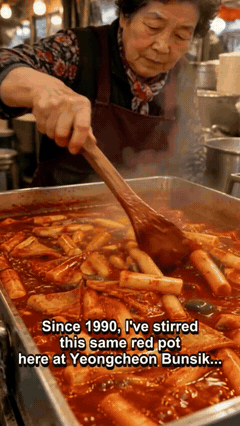
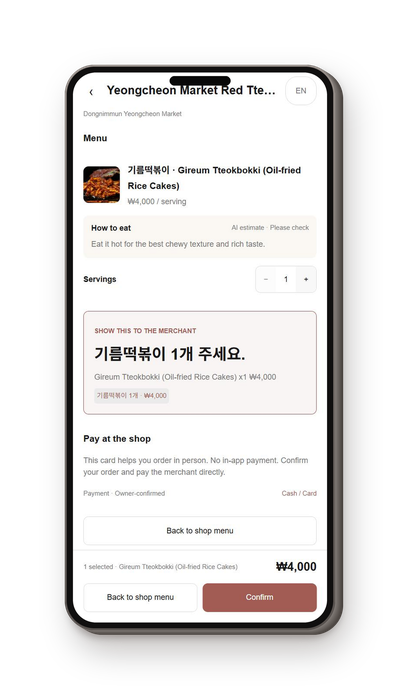
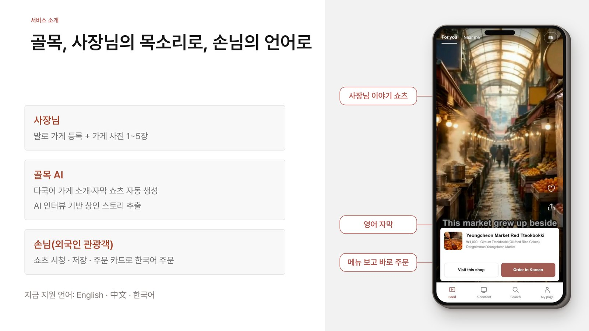
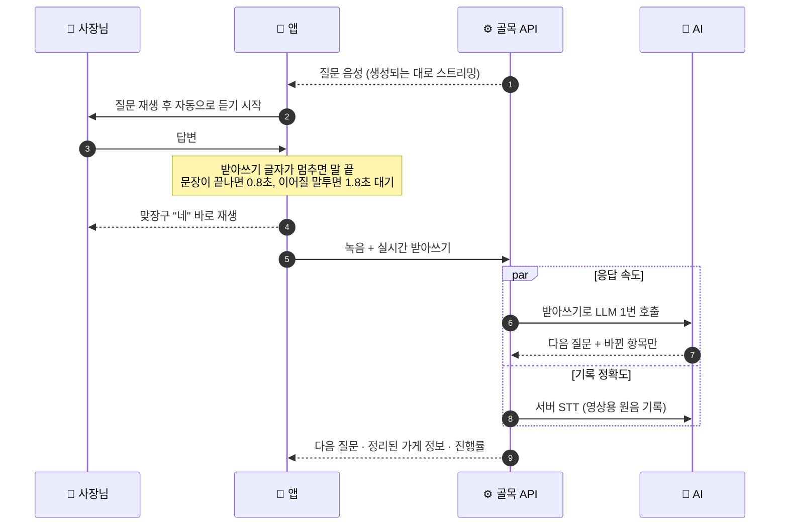
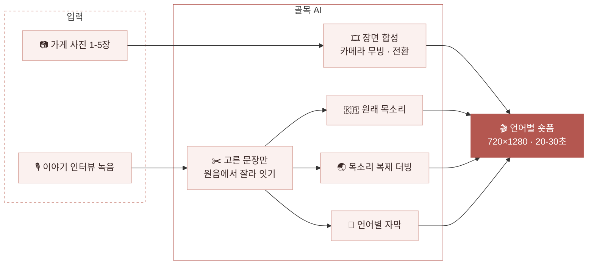

<p align="center">
  
</p>

<h1 align="center">골목 GOLMOK</h1>

<p align="center">
  <b>사장님의 목소리로, 손님의 언어로</b><br>
  사장님은 <b>전화 받듯 말하고 사진만 찍으면</b> 됩니다.<br>
  AI가 <b>다국어 가게 정보</b>와 <b>사장님 목소리로 더빙된 숏폼</b>을 만들어 외국인 손님에게 보여줍니다.
</p>

<p align="center">
  
</p>

<p align="center">
  
  
  
  
  
  
</p>

> 🏆 **명지대학교 2026학년도 AI 창의적 아이디어 해커톤 경진대회 최우수상**<br>
> 이 저장소는 골목의 백엔드(API)입니다. 원본: [Gopistol/hackathon-api](https://github.com/Gopistol/hackathon-api)

<p align="center">
  <a href="#데모">데모</a> ·
  <a href="#문제-정의">문제 정의</a> ·
  <a href="#왜-서대문구인가">왜 서대문구인가</a> ·
  <a href="#서비스-흐름">서비스 흐름</a> ·
  <a href="#설계-원칙">설계 원칙</a> ·
  <a href="#핵심-기술">핵심 기술</a> ·
  <a href="#기대-효과와-확장">기대 효과</a> ·
  <a href="#기술-스택">기술 스택</a>
</p>

| 🎙️ 말로 등록 | 🎬 사진 → 숏폼 | 🗣️ 사장님 목소리 | 🌏 3개 언어 |
| :---: | :---: | :---: | :---: |
| 버튼 대신 전화하듯<br>AI와 대화해 가게 등록 | 사진 1-5장으로<br>20-30초 세로 영상 | 외국어 영상도<br>목소리 복제로 더빙 | English · 中文 · 한국어<br>메뉴·자막·주문 카드 |

## 데모

가게 사진과 사장님의 이야기로 만든 골목 숏폼 예시입니다. 언어마다 자막이 들어간 영상을 따로 만들고, 사장님 목소리로 더빙합니다.

<p align="center">
  
  &nbsp;
  
  &nbsp;
  
</p>

<table>
  <tr>
    <td align="center" width="25%"></td>
    <td align="center" width="25%"></td>
    <td align="center" width="25%"></td>
    <td align="center" width="25%"></td>
  </tr>
  <tr>
    <td align="center"><b>사장님 등록</b><br><sub>말로 가게 정보 입력</sub></td>
    <td align="center"><b>숏폼 피드</b><br><sub>사장님 이야기 쇼츠</sub></td>
    <td align="center"><b>K-콘텐츠</b><br><sub>드라마 속 음식 찾기</sub></td>
    <td align="center"><b>주문 카드</b><br><sub>한국어로 보여주면 주문 끝</sub></td>
  </tr>
</table>

## 문제 정의

외국인은 K-드라마와 숏폼에서 본 음식을 먹으러 시장에 오지만, 정작 시장 앞에서 **메뉴를 읽을 수 없습니다.**
수십 년 한자리를 지킨 사장님에게는 이야기가 있지만, **그 이야기를 외국인에게 전할 방법이 없습니다.**
보고 싶은 사람과 보여주고 싶은 사람이 있는데, 그 사이가 끊겨 있습니다.

| 외국인 관광객 | 시장 사장님 |
| :---: | :---: |
|  |  |
| 한국에 관심을 갖게 된 계기 1위 **한류 콘텐츠(38.3%)**<br>여행지를 고를 때 1순위 **식도락(61.7%)**<br>하지만 여행 불편 1위는 **언어 소통** | 상인 평균 나이 **60.2세**, 60대 이상 **57.6%**<br>메뉴판 번역·디자인 외주는 비용 부담<br>릴스·카드뉴스를 만들 사람도, 기술도 없음 |
| 메뉴 오역·가격 논란 보도로 **시장에 대한 신뢰 하락** | 일부 논란에도 **성실한 가게까지 손님이 끊김** |

<sub>출처: 한국관광공사 외래관광객조사(2024·2025), 음식관광 실태조사(2019), 소상공인시장진흥공단 전통시장 점포경영 실태조사(2022)</sub>

## 왜 서대문구인가

<p align="center">
  
</p>

서울 열린데이터광장의 생활인구 데이터를 직접 분석해 첫 무대를 골랐습니다.

- 학기 중 평일 낮 **장기체류 외국인 생활인구 18,629명**으로 서울 25개 구 중 2위
- 낮 시간 **20-24세 비중 서울 2위**(9.6%), 서울 평균(5.4%)의 1.8배
- **영천시장·포방터시장**이 2026 문화관광형시장에 동시 선정

외국인 손님이 이미 가까이 있고, 시장도 관광객을 맞을 준비를 시작한 곳입니다.

## 서비스 흐름

<p align="center">
  
</p>

| | 하는 일 | 결과 |
| :---: | --- | --- |
| **사장님** | AI와 통화하듯 가게를 소개하고 사진 1-5장 업로드 | 장사 중에도 1분 남짓이면 등록 |
| **골목 AI** | 대화 정리 → 사실 검증 → 다국어 번역 → 숏폼 렌더링 | 다국어 가게 정보 + 사장님 목소리 숏폼 |
| **손님** | 피드에서 쇼츠 시청 → 가게 상세 → 주문 카드 | 한국어 주문 카드를 사장님께 보여주면 주문 끝 |

## 설계 원칙

문제 정의에서 나온 세 가지 관찰을 그대로 설계 원칙으로 삼았습니다.

| 관찰 | 설계 원칙 | 구현 |
| --- | --- | --- |
| 사장님 절반 이상이 60대 이상. 입력 폼과 키보드가 곧 장벽 | **말만 하면 끝난다** | [통화형 AI 인터뷰](#1-말만-하면-끝나는-등록--통화형-ai-인터뷰) |
| 오역과 가격 논란으로 시장의 신뢰가 흔들림 | **지어내지 않는다** | [사실 검증과 문장 선택](#2-지어내지-않는-ai--사장님이-한-말만-쓴다)<br>[실제 사진과 목소리로 만드는 숏폼](#3-진짜-사진-진짜-목소리--사장님-숏폼) |
| 시끄러운 시장, 낯선 기술 앞의 어르신 | **어떤 상황에서도 멈추지 않는다** | [단계별 시간 제한과 대체 경로](#4-멈추지-않는-흐름--단계별-대체-경로) |

## 핵심 기술

### 1. 말만 하면 끝나는 등록 · 통화형 AI 인터뷰

> 어르신에게 가장 익숙한 인터페이스는 앱 화면이 아니라 **전화 통화**입니다.
> 골목은 AI가 묻고 사장님이 대답하는 것만으로 가게 등록과 이야기 수집을 끝냅니다. 누를 버튼도, 채울 입력칸도 없습니다.



**대화가 끊기지 않게, 한 턴 1-3초**<br>
통화에서 침묵이 길어지면 사장님은 전화가 끊긴 줄 압니다. 브라우저의 실시간 받아쓰기로 다음 질문을 바로 만들고, 정확한 서버 STT는 동시에 돌려 기록에만 씁니다.
LLM은 한 턴에 한 번만 부르고 할 말과 바뀐 항목만 출력하게 해 응답을 줄였습니다. 질문 음성은 생성되는 대로 스트리밍하고, 기다리는 동안에는 맞장구를 먼저 들려줍니다.

**시끄러운 시장에서도 말 끝을 정확히**<br>
소리 크기로 말 끝을 판단하면 시장 소음 때문에 녹음이 끝나지 않습니다. 골목은 받아쓰기 글자가 더 이상 늘지 않는 순간을 말 끝으로 봅니다.
문장이 "요", "다"로 끝나면 짧게, "그래서"처럼 말이 이어질 것 같으면 길게 기다립니다. 스피커로 나간 AI 질문이 마이크로 다시 들어오는 경우도 걸러냅니다.

**잘못 들어도 스스로 바로잡기**<br>
서버 STT와 브라우저 받아쓰기 결과가 다르면 둘 다 LLM에 넘겨 맥락에 맞는 쪽을 고르게 합니다("분식집" / "한식집").
"만 오천 원", "서른다섯 해" 같은 한글 숫자도 직접 해석해 가격과 연수로 바꿉니다.

**어르신을 지치게 하지 않는 대화**<br>
같은 항목은 두 번까지만 묻고, 그래도 못 들으면 마지막 요약 화면의 확인 목록으로 넘깁니다. 사장님 말을 앵무새처럼 되풀이하는 표현과 중복 질문은 걸러내고, "그만할게요" 한마디면 언제든 끝납니다.
가게 등록은 이름 → 업종 → 상품·가격 → 결제 → 영업시간을 묻고 업종에 따라 원산지·맵기·택배 같은 질문을 더합니다.
이야기 인터뷰는 시작 · 세월 · 손맛 · 사람 · 손님께 한마디의 다섯 축으로 꼬리 질문을 이어 갑니다.

### 2. 지어내지 않는 AI · 사장님이 한 말만 쓴다

> 오역과 가격 논란으로 흔들린 신뢰는 그럴듯한 AI 문장으로 회복되지 않습니다.
> 골목의 AI는 사장님 말을 **정리하고 번역할 뿐, 새로 지어내지 않도록** 설계했습니다.

**LLM 결과를 원문과 대조 검증**<br>
LLM이 정리한 가게 정보는 사장님이 실제로 한 말과 대조합니다. 말한 적 없는 상품은 빼고, 비슷하지만 다른 이름은 확인 목록에 올립니다.
이번 답에 숫자가 없는데 가격이 생겼거나 시간 표현 없이 영업시간이 바뀌었다면 이전 값으로 되돌립니다. 결제 수단도 언급한 것만 남깁니다.

**이야기는 쓰지 않고 고른다**<br>
숏폼에 들어갈 이야기는 LLM이 새로 쓰지 않습니다. 사장님 답을 문장 단위로 나눠 번호를 붙이고, LLM은 이야기 순서에 맞는 **문장 번호만** 고릅니다.
구조적으로 사장님이 하지 않은 말은 영상에 들어갈 수 없습니다.

**음식 용어집으로 정확한 번역과 식이 정보**<br>
떡볶이, 빈대떡, 꽈배기 등 시장 음식 21종의 영어·중국어 이름, 설명, 먹는 법, 맵기를 용어집으로 정리했습니다.
맵기는 AI 추측보다 용어집 값을 우선하고, 번역이 실패해도 용어집으로 메뉴를 보여줍니다.

### 3. 진짜 사진, 진짜 목소리 · 사장님 숏폼

> 생성형 영상은 실제와 다른 음식을 보여줄 수 있습니다. 손님이 화면에서 본 그 음식이 시장에 그대로 있어야 합니다.
> 그래서 골목 숏폼은 **실제 가게 사진과 사장님의 실제 녹음**만으로 만듭니다.



**사장님 육성 그대로 편집**<br>
음성 정렬(forced alignment)로 고른 문장이 녹음의 몇 초에 있는지 글자 단위로 찾아 그 구간만 잘라 잇습니다. 30초를 넘으면 뒤 문장부터 덜어냅니다.
한국어 영상에는 사장님 원래 목소리가 그대로 들어갑니다.

**외국어로 말하는 사장님**<br>
영어·중국어 영상은 사장님 목소리를 복제해 그 언어로 더빙합니다. 손님은 자기 언어로, 사장님 목소리로 이야기를 듣습니다.

**모바일에서 읽기 좋은 자막**<br>
자막은 음성의 글자별 시각에 맞춰 나타납니다. 한 화면 글자 수를 언어별로 정했고(한국어 24자, 중국어 20자, 영어 52자), 피드 하단의 가게 카드에 가리지 않는 위치에 넣었습니다.
자막을 영상에 직접 넣은 언어별 영상과 플레이어용 VTT를 함께 만듭니다.

**편집한 듯한 완성도**<br>
사진마다 다른 카메라 움직임과 부드러운 장면 전환을 넣고, 시작에는 가게 이름을, 끝에는 메뉴·가격·결제 카드를 보여줍니다. 카드에는 AI 문장이 아니라 DB에 저장된 값만 씁니다.
사진이 한 장뿐이어도 확대·이동·축소 구간을 나눠 20-30초를 채웁니다.

### 4. 멈추지 않는 흐름 · 단계별 대체 경로

> 어르신 사용자에게 에러 화면은 곧 이탈입니다. 외부 AI가 느리거나 실패해도 사장님이 겪는 흐름은 끊기지 않아야 합니다.
> 그래서 단계마다 **시간 제한과 다음 수단**을 정해 두었습니다.

| 단계 | 시간 제한 | 느리거나 실패하면 |
| --- | :---: | --- |
| 음성 인식 | 6초 | 브라우저 받아쓰기 사용, 그래도 없으면 에러 대신 같은 질문을 다시 하고 반복되면 말하기 요령 안내 |
| 인터뷰 한 턴 | 8초 | 고정 질문 + 규칙 기반 정리로 같은 흐름 유지 |
| 번역 | - | 음식 용어집 → 한국어 원문 |
| 더빙 | 25초 | 목소리 복제 → AI 기본 목소리 → 사장님 원음 → 자막만 있는 영상 |
| 자막 시간 맞추기 | 15초 | 글자 수 비율로 시간 배분 |

API 키가 없어도 전체 흐름이 mock 모드로 동작하도록 LLM 호출을 프로바이더 인터페이스(`openai` · `anthropic` · `mock`) 뒤로 분리했습니다. 덕분에 테스트는 네트워크와 키 없이 실제 ffmpeg 렌더링까지 검증합니다.
서버는 메모리 600MB에서 동작하도록 렌더링을 한 번에 하나씩 처리하고, 중간에 멈춘 작업은 재시작할 때 정리합니다.

## 기대 효과와 확장

<p align="center">
  
</p>

| 대상 | 효과 | 지표 |
| --- | --- | --- |
| 외국인 관광객 | 화면 속 음식을 시장에서 직접 맛보고, 가게의 이야기까지 경험 | 영상 시청 후 저장·길찾기로 이어진 비율 |
| 시장 사장님 | 사진과 30초 음성만으로 다국어 메뉴·홍보 영상 확보 | 언어별 영상 조회 수, 주문 수 |
| 서대문구·상인회 | 나라별 손님 수요 데이터로 시장 지원 정책 근거 확보 | 나라별 방문 수, 인기 메뉴 순위 |

<p align="center">
  
</p>

**영천·포방터시장 → 서대문구 전통시장·상가 11곳 → 서울, 그리고 전국.**
시장과 가게 데이터를 추가하는 것만으로 확장되는 구조입니다. 언어는 서대문구에 오래 사는 외국인의 국적 순서에 맞춰 日本語 · Tiếng Việt · Français로 넓힙니다.

## 기술 스택

| 영역 | 사용 기술 |
| --- | --- |
| API 서버 | FastAPI, Pydantic Settings, Uvicorn |
| DB | SQLite + SQLAlchemy 2.x |
| LLM | OpenAI `gpt-4.1-mini` (프로바이더 교체 가능: `openai` · `anthropic` · `mock`) |
| 음성 | STT: OpenAI `gpt-4o-mini-transcribe`<br>TTS · 목소리 복제 · 음성 정렬: ElevenLabs<br>TTS 대체: OpenAI `gpt-4o-mini-tts` |
| 영상 | ffmpeg (imageio-ffmpeg), Pillow |
| 배포 | VM + systemd + Caddy (메모리 600MB, 워커 1개) |

<details>
<summary><b>실행 방법</b></summary>

```bash
python3 -m venv .venv
.venv/bin/pip install -r requirements-dev.txt
cp .env.example .env                        # 키가 없으면 mock 모드로 전체 흐름이 동작
.venv/bin/uvicorn app.main:app --reload     # http://127.0.0.1:8000/docs
.venv/bin/pytest                            # 네트워크·키 없이 테스트
```

API 명세, 환경변수, 시드·리셋, 서버 배포 방법은 [개발 문서](docs/DEVELOPMENT.md)에 정리했습니다.

</details>

<details>
<summary><b>프로젝트 구조</b></summary>

```text
app/
├── api/v1/          # customer(피드·가게·주문) · merchant(등록·인터뷰·영상) · admin(리셋)
├── services/
│   ├── interview.py # 통화형 AI 인터뷰 (가게 등록 · 이야기), 원문 대조 검증
│   ├── video.py     # 숏폼 렌더링 · 더빙 · 원음 구간 잇기
│   ├── subtitles.py # 음성 정렬 기반 자막 타이밍
│   ├── ai.py        # STT · 정리 · 번역 (mock · 실패 대체 포함)
│   ├── i18n.py      # 언어 · 음식 용어집
│   └── elevenlabs.py, tts.py, maps.py, onboarding.py
├── llm/             # LLM 프로바이더 (openai · anthropic · mock)
├── prompts.py       # 시스템 프롬프트
└── seed_data.py     # 예시 시장 · 가게 · K-콘텐츠
demo/                # 예시 영상 · 사진 · K-콘텐츠 카드
docs/                # 개발 문서 · README 이미지
```

</details>

---

<p align="center">
  <b>모든 골목에, 새로운 맛</b><br>
  <i>Every alley, a new flavor.</i><br><br>
  <sub>일부 사진과 영상 예시에는 AI로 생성한 이미지를 사용했습니다.</sub>
</p>
