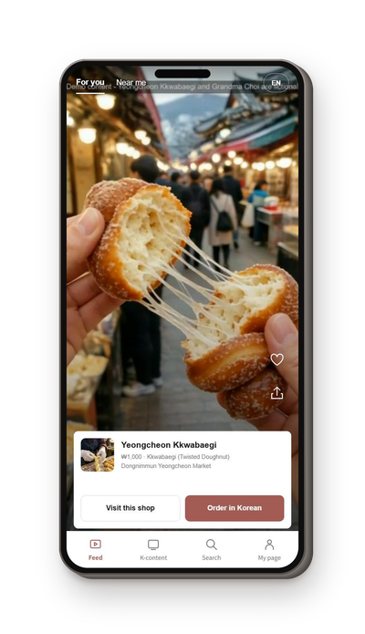
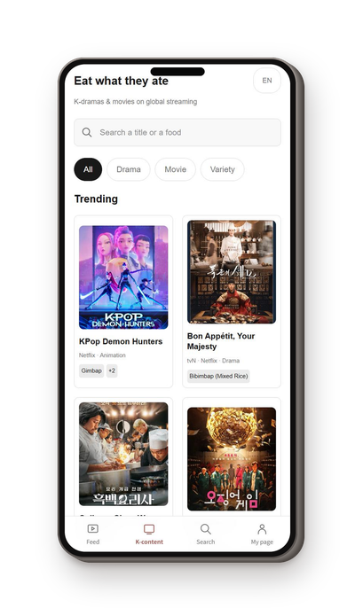
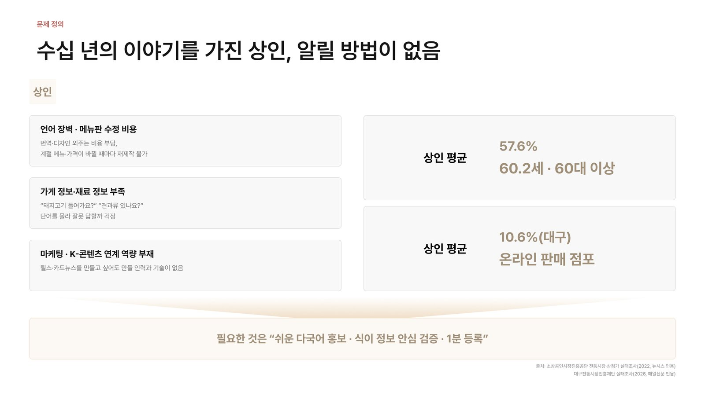
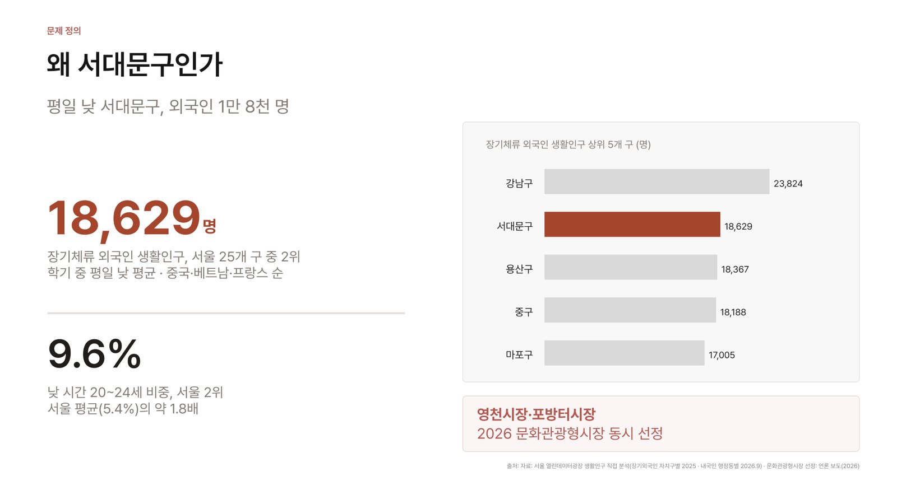
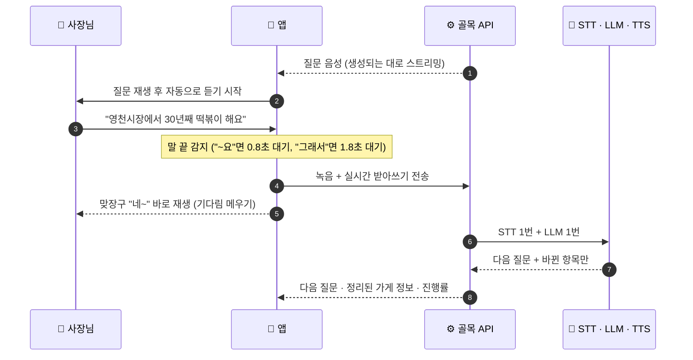
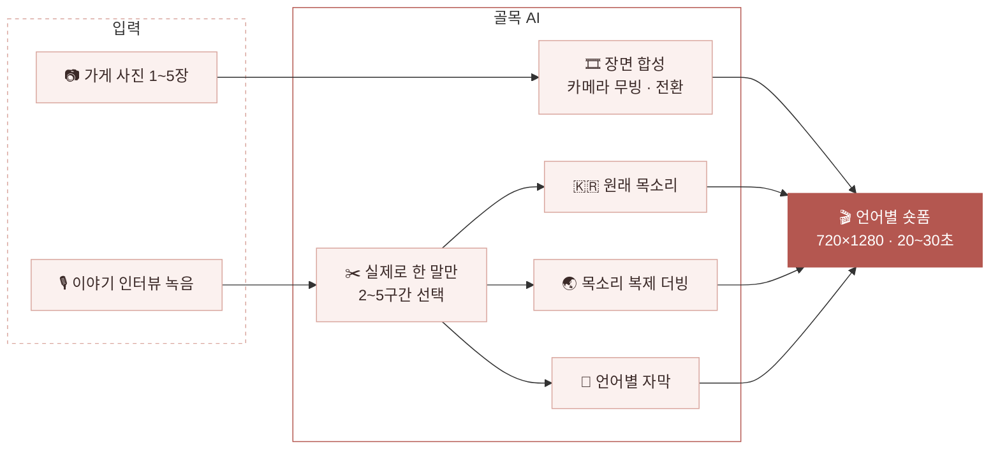
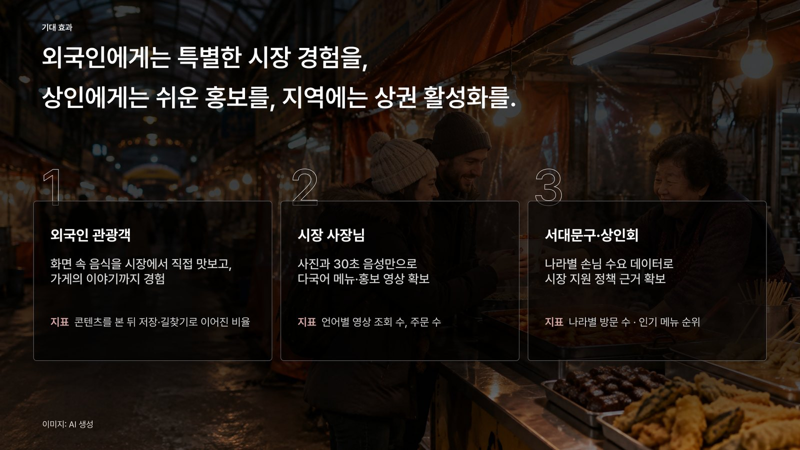

<p align="center">
  
</p>

<h1 align="center">골목 GOLMOK</h1>

<p align="center">
  <b>사장님의 목소리로, 손님의 언어로</b><br>
  사장님은 <b>전화 받듯 말하고 사진만 찍으면</b> 됩니다.<br>
  AI가 <b>다국어 가게 정보</b>와 <b>사장님 목소리로 더빙된 숏폼</b>을 만들어 외국인 손님에게 보여줍니다.
</p>

<p align="center">
  
</p>

<p align="center">
  
  
  
  
  
  
</p>

> 🏆 **명지대학교 2026학년도 AI 창의적 아이디어 해커톤 경진대회 최우수상**<br>
> 이 저장소는 골목의 백엔드(API)입니다. 원본: [Gopistol/hackathon-api](https://github.com/Gopistol/hackathon-api)

<p align="center">
  <a href="#데모">데모</a> ·
  <a href="#문제-정의">문제 정의</a> ·
  <a href="#왜-서대문구인가">왜 서대문구인가</a> ·
  <a href="#서비스-흐름">서비스 흐름</a> ·
  <a href="#핵심-기술">핵심 기술</a> ·
  <a href="#기대-효과와-확장">기대 효과</a> ·
  <a href="#기술-스택">기술 스택</a>
</p>

| 🎙️ 말로 등록 | 🎬 사진 → 숏폼 | 🗣️ 사장님 목소리 | 🌏 3개 언어 |
| :---: | :---: | :---: | :---: |
| 버튼 대신 전화하듯<br>AI와 대화해 가게 등록 | 사진 1~5장으로<br>20~30초 세로 영상 | 외국어 영상도<br>목소리 복제로 더빙 | English · 中文 · 한국어<br>메뉴·자막·주문 카드 |

## 데모

AI가 사진과 사장님 이야기로 만든 숏폼입니다. 언어별로 자막을 영상에 넣고, 사장님 목소리로 더빙합니다.

<p align="center">
  
  &nbsp;
  
  &nbsp;
  
</p>

<table>
  <tr>
    <td align="center" width="25%"></td>
    <td align="center" width="25%"></td>
    <td align="center" width="25%"></td>
    <td align="center" width="25%"></td>
  </tr>
  <tr>
    <td align="center"><b>사장님 등록</b><br><sub>말로 가게 정보 입력</sub></td>
    <td align="center"><b>숏폼 피드</b><br><sub>사장님 이야기 쇼츠</sub></td>
    <td align="center"><b>K-콘텐츠</b><br><sub>드라마 속 음식 찾기</sub></td>
    <td align="center"><b>주문 카드</b><br><sub>한국어로 보여주면 주문 끝</sub></td>
  </tr>
</table>

## 문제 정의

외국인은 K-드라마와 숏폼에서 본 음식을 먹으러 시장에 오지만 **메뉴를 읽을 수 없습니다.**
수십 년 장사한 사장님은 **그 이야기를 외국인에게 전할 방법이 없습니다.**

| 외국인 관광객 | 시장 사장님 |
| :---: | :---: |
|  |  |
| 한국에 관심을 갖게 된 계기 1위 **한류 콘텐츠(38.3%)**<br>여행지를 고를 때 1순위 **식도락(61.7%)**<br>하지만 여행 불편 1위는 **언어 소통** | 상인 평균 나이 **60.2세**, 60대 이상 **57.6%**<br>메뉴판 번역·디자인 외주는 비용 부담<br>릴스·카드뉴스를 만들 사람도, 기술도 없음 |

<sub>출처: 한국관광공사 외래관광객조사(2024·2025), 음식관광 실태조사(2019), 소상공인시장진흥공단 전통시장 점포경영 실태조사(2022)</sub>

## 왜 서대문구인가

<p align="center">
  
</p>

서울 열린데이터광장의 생활인구 데이터를 직접 분석했습니다. 서대문구는 학기 중 평일 낮 **장기체류 외국인 생활인구가 서울 2위**(18,629명)입니다.
낮 시간 **20~24세 비중도 서울 2위**(9.6%, 서울 평균의 1.8배)입니다. 2026년에는 **영천시장과 포방터시장**이 문화관광형시장에 함께 선정되었습니다.

## 서비스 흐름

<p align="center">
  
</p>

| | 하는 일 | 결과 |
| :---: | --- | --- |
| **사장님** | AI와 통화하듯 가게를 소개하고 사진 1~5장 업로드 | 1분 안팎으로 가게 등록 |
| **골목 AI** | 대화 정리 → 다국어 번역 → 숏폼 렌더링 | 다국어 가게 정보 + 사장님 목소리 숏폼 |
| **손님** | 피드에서 쇼츠 시청 → 가게 상세 → 주문 카드 | 한국어 주문 카드를 사장님께 보여주면 주문 끝 |

## 핵심 기술

### 1. 통화형 AI 인터뷰: 화면을 몰라도, 말만 하면 등록

사장님 대부분이 60대 이상입니다. 그래서 입력 폼 대신 **AI가 묻고 사장님이 대답하는 통화**로 등록을 설계했습니다.



- **한 턴에 1~3초:** 음성 인식과 LLM을 각각 한 번만 호출합니다. LLM은 할 말과 바뀐 항목만 출력하고, 질문 음성은 생성되는 대로 스트리밍합니다.
- **시장 소음에도 끊기지 않음:** 소리 크기 대신 "받아쓰기 글자가 멈췄는지"로 말 끝을 판단합니다. "~요"처럼 문장이 끝나면 짧게, "그래서"처럼 이어질 것 같으면 길게 기다립니다.
- **잘못 들은 단어 바로잡기:** 서버 STT와 브라우저 받아쓰기 결과를 함께 LLM에 넘겨, 한쪽이 틀리게 들어도(분식집 → 한식집) 바로잡습니다.
- **업종 맞춤 질문:** 가게 이름 → 상품·가격 → 결제 → 영업시간을 묻고, 업종별로 원산지·맵기·택배 같은 질문을 더합니다. 사장님이 말로 고치면 다음 턴에 반영합니다.
- **이야기 인터뷰:** 시작 · 세월 · 손맛 · 사람 · 한마디의 다섯 축으로 꼬리 질문을 이어 가며 숏폼에 쓸 사장님의 이야기를 끌어냅니다.

### 2. 사장님 목소리 숏폼: 진짜 사진, 진짜 목소리

생성형 영상은 실제 음식과 다르게 보일 수 있어 신뢰를 잃습니다. 그래서 **실제 가게 사진과 사장님의 실제 녹음**만으로 영상을 만듭니다.



- **환각 없는 이야기:** LLM이 인터뷰 답변에서 쓸 구간을 고르면, 원문에 없는 문장은 버립니다. 영상에는 사장님이 실제로 한 말만 들어갑니다.
- **원래 녹음에서 잘라 잇기:** 음성 정렬로 고른 문장이 녹음의 어느 시간에 있는지 찾아, 그 구간만 잘라 30초 안팎의 이야기로 잇습니다.
- **목소리 복제 더빙:** 외국어 영상은 사장님 목소리를 복제해 그 언어로 읽게 합니다. 손님은 자기 언어로 사장님 목소리를 듣습니다.
- **사진 한 장이어도 충분:** 사진 수에 맞춰 확대·이동·축소 구간을 나눠 20~30초를 채웁니다.

### 3. 라이브 데모가 멈추지 않도록

해커톤은 무대에서 한 번에 시연해야 합니다. 그래서 외부 AI 호출마다 대체 경로를 두어, 어느 단계가 실패해도 흐름이 끝까지 이어지게 했습니다.

| 단계 | 실패하면 |
| --- | --- |
| 음성 인식 | 에러 대신 같은 질문을 다시 하고, 반복되면 말하기 팁을 안내 |
| LLM 정리 | 고정 질문 + 규칙 기반 정리로 같은 흐름 유지 |
| 번역 | 음식 용어집 → 한국어 원문 |
| 더빙 | 목소리 복제 → AI 기본 목소리 → 사장님 원음 → 무음 영상 |
| 렌더링 | 작업 실패 처리, 미리 만든 시연 영상은 피드에 그대로 |

## 기대 효과와 확장

<p align="center">
  
</p>

| 대상 | 효과 | 지표 |
| --- | --- | --- |
| 외국인 관광객 | 화면 속 음식을 시장에서 직접 맛보고, 가게의 이야기까지 경험 | 영상 시청 후 저장·길찾기로 이어진 비율 |
| 시장 사장님 | 사진과 30초 음성만으로 다국어 메뉴·홍보 영상 확보 | 언어별 영상 조회 수, 주문 수 |
| 서대문구·상인회 | 나라별 손님 수요 데이터로 시장 지원 정책 근거 확보 | 나라별 방문 수, 인기 메뉴 순위 |

<p align="center">
  
</p>

**영천·포방터시장 → 서대문구 전통시장·상가 11곳 → 서울, 그리고 전국.**
언어는 서대문구에 오래 사는 외국인의 국적 순서에 맞춰 日本語 · Tiếng Việt · Français로 넓힙니다.

## 기술 스택

| 영역 | 사용 기술 |
| --- | --- |
| API 서버 | FastAPI, Pydantic Settings, Uvicorn |
| DB | SQLite + SQLAlchemy 2.x |
| LLM | OpenAI `gpt-4.1-mini` (프로바이더 교체 가능: `openai` · `anthropic` · `mock`) |
| 음성 | STT: OpenAI `gpt-4o-mini-transcribe`<br>TTS·목소리 복제·음성 정렬: ElevenLabs<br>TTS 대체: OpenAI `gpt-4o-mini-tts` |
| 영상 | ffmpeg (imageio-ffmpeg), Pillow |
| 배포 | VM + systemd + Caddy (메모리 600MB, 워커 1개) |

<details>
<summary><b>실행 방법</b></summary>

```bash
python3 -m venv .venv
.venv/bin/pip install -r requirements-dev.txt
cp .env.example .env                        # 키가 없으면 mock 모드로 전체 흐름이 동작
.venv/bin/uvicorn app.main:app --reload     # http://127.0.0.1:8000/docs
.venv/bin/pytest                            # 네트워크·키 없이 테스트
```

API 명세, 환경변수, 시드·리셋, 서버 배포 방법은 [개발 문서](docs/DEVELOPMENT.md)에 정리했습니다.

</details>

<details>
<summary><b>프로젝트 구조</b></summary>

```text
app/
├── api/v1/          # customer(피드·가게·주문) · merchant(등록·인터뷰·영상) · admin(리셋)
├── services/
│   ├── interview.py # 통화형 AI 인터뷰 (가게 등록 · 이야기)
│   ├── video.py     # 숏폼 렌더링 · 더빙 · 이야기 구간 잇기
│   ├── ai.py        # STT · 정리 · 번역 · 자막 (mock · 실패 대체 포함)
│   └── elevenlabs.py, tts.py, subtitles.py, i18n.py, maps.py, onboarding.py
├── llm/             # LLM 프로바이더 (openai · anthropic · mock)
├── prompts.py       # 시스템 프롬프트
└── seed_data.py     # 시연용 시장 · 가게 · K-콘텐츠
demo/                # 시연 영상 · 사진 · K-콘텐츠 카드
docs/                # 개발 문서 · README 이미지
```

</details>

---

<p align="center">
  <b>모든 골목에, 새로운 맛</b><br>
  <i>Every alley, a new flavor.</i><br><br>
  <sub>발표 자료의 일부 사진은 AI로 생성한 이미지입니다.</sub>
</p>
